<h1 align="center">🌱 AgriGenesis AI</h1>

<p align="center">
  <b>🏆 Cognizant BrAInstorm Challenge 2026 · Agentic AI for Good</b><br>
  <b>Team AgriCan</b>: <a href="https://github.com/venky-22">Venkateshwaran Mohan</a> · <a href="https://github.com/dilmilsoach">Dilmil</a> · <a href="https://github.com/S-M-J-I">Jishanul</a>
</p>

<p align="center"><b>An AI agent that turns bare land into a farm plan, using only real public data.</b><br>
Built for Nova Scotia’s new farmers.</p>

<p align="center">
  
  
  
  
  
  
  
  <a href="LICENSE"></a>
</p>

<p align="center">
  🎬 <a href="submission/AgriGenesis%20AI%20-%20demo%20video.mp4"><b>Demo video</b></a> · 📑 <a href="submission/AgriGenesis%20AI%20-%20slide%20deck.pptx"><b>Slide deck</b></a> · 📁 <a href="submission"><b>All submission files</b></a>
</p>

<p align="center">
  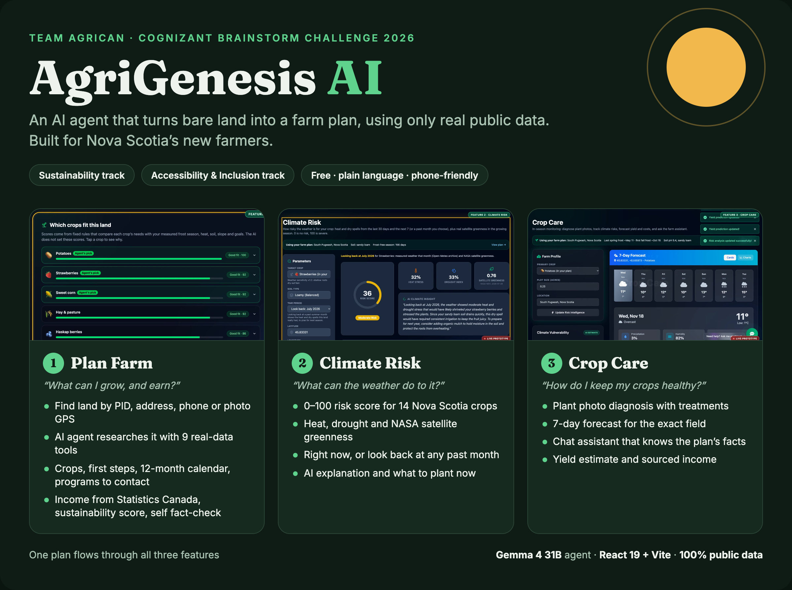
</p>

### At a glance

- 🤖 **A real AI agent:** it picks its own tools, gathers real data, writes the plan, then fact-checks and corrects itself.
- 🗺️ **Start from anything a new owner has:** a property ID (PID), an address, a phone location or a photo.
- 📊 **Every number has a source:** Environment Canada, NASA, Agriculture Canada and Statistics Canada. Nothing is made up.
- 🌾 **One plan, three features:** Plan Farm → Climate Risk → Crop Care, with the plan's facts carried through.
- ♿ **Free, plain language, phone-friendly:** no agronomist needed.

## Team AgriCan

| Teammate | GitHub |
|---|---|
| Venkateshwaran Mohan | [@venky-22](https://github.com/venky-22) |
| Dilmil | [@dilmilsoach](https://github.com/dilmilsoach) |
| Jishanul | [@S-M-J-I](https://github.com/S-M-J-I) |

Built for the **Cognizant BrAInstorm Challenge 2026** (theme: *Agentic AI for Good*), in the **Sustainability** and **Accessibility & Inclusion** tracks.

## How AgriGenesis AI meets the judging criteria

| Criterion | Where to see it |
|---|---|
| **Idea & innovation (20%)** | |
| Problem statement and business relevance | 280,000 acres of Nova Scotia farmland change hands by 2033 and 35.7% of farmers have no successor. New owners need a plan that today costs an agronomist, soil tests and research. See [The problem](#the-problem). |
| Innovation | An agent that researches a specific piece of land with 9 real-data tools, then fact-checks and corrects its own plan. Every number shows its source. |
| Feasibility | Working today on free public data, with one AI model behind one server endpoint. No sensors, hardware or paid data. |
| **MVP evaluation (60%)** | |
| Functionality | Three working features that share one plan: [Plan Farm, Climate Risk and Crop Care](#the-three-features), shown end to end in the demo video. |
| Agentic AI usage | Tool-calling loop (up to 12 rounds), a guardrail that sends the agent back if it skips checks, self-review and self-correction, and memory shared with the other features. See [How the AI agent works](#how-the-ai-agent-works-agentic-ai). |
| Technical implementation | React 19 + Vite, Gemma 4 31B with function calling, and 9 data tools across Environment Canada, NASA, Agriculture Canada, Open-Meteo, the NS property registry and Statistics Canada. See [Architecture](#architecture). |
| Code quality | Separate modules for agent, data, rules, economics, sustainability and verification (`src/agent/`); documented functions; **32 automated tests** (`npm test`) that pin the crop rules, Statistics Canada income, sustainability score and fact-checker to the results in the demo; ESLint passes with no errors. |
| Security | The AI key stays on the server (no `VITE_` prefix, `.env` is git-ignored). No accounts and no server database: the plan stays in the farmer's browser. Tools are locked to the verified coordinates, and tool inputs are restricted to known values. |
| Scalability | Most data sources are national or global (Environment Canada, Agriculture Canada, NASA, Open-Meteo, Statistics Canada), so the agent is not tied to Nova Scotia. A new province mainly needs its crop list, cost studies and property registry. The app is static, with one AI proxy endpoint that deploys as a serverless function. |
| Performance | The agent runs the tool calls it requests in parallel, and data fetches run in parallel too. Public-data calls time out at 30 s and retry once. A plan for the same inputs on the same day is reused instead of calling the AI again. |
| **Presentation (20%)** | A demo video under 3 minutes, a 10-slide deck, and this README with diagrams and screenshots. |

## Contents

- [Team AgriCan](#team-agrican)
- [How AgriGenesis AI meets the judging criteria](#how-agrigenesis-ai-meets-the-judging-criteria)
- [The problem](#the-problem)
- [Our solution](#our-solution)
- [The three features](#the-three-features)
- [How the AI agent works (agentic AI)](#how-the-ai-agent-works-agentic-ai)
- [Architecture](#architecture)
- [Why it can be trusted](#why-it-can-be-trusted)
- [Getting started](#getting-started)
- [Submission files](submission)
- [Project layout](#project-layout)
- [Known limitations](#known-limitations)
- [Roadmap](#roadmap)

---

## The problem

<p align="center">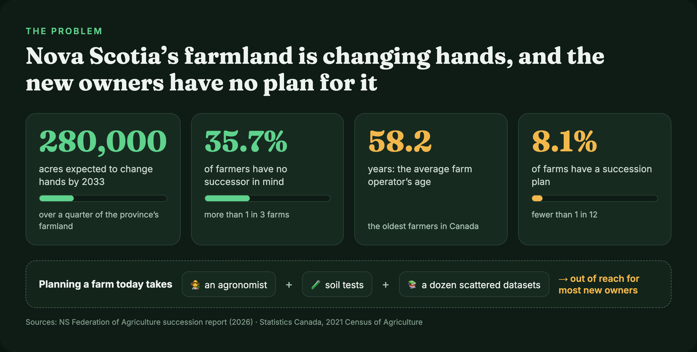</p>

Nova Scotia's farmland is changing hands, and the new owners often have land but no plan for it. Planning a farm normally takes an agronomist, soil tests and research across a dozen scattered climate and government datasets. Most first-time owners can't afford that, so good land sits idle or gets sold off.

<sub>Sources: Nova Scotia Federation of Agriculture succession report (2026); Statistics Canada, 2021 Census of Agriculture.</sub>

## Our solution

<p align="center">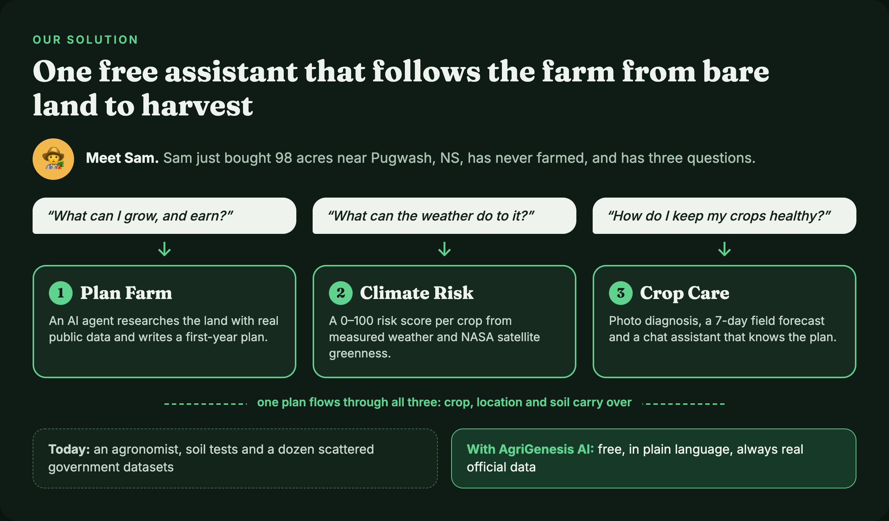</p>

AgriGenesis AI is a free assistant that follows the farm from bare land to harvest. One plan flows through all three features: crop, location and soil carry over, so the farmer never re-enters anything.

**Example used in our demo:** Sam just bought 98 acres near Pugwash, NS (PID 25158932) and has never farmed.

## The three features

### Feature 1 · Plan Farm (`/plan-farm` → `/farm-plan`)

1. **Find the land** by PID (the 8-digit property number on the deed or property tax notice), street address, phone location, or the GPS saved in a photo. A PID loads the parcel boundary from the Nova Scotia property registry. The field can also be outlined on a satellite map.
2. **Set goals:** income or household food, experience, budget and time available.
3. **The agent researches the land** and builds a first-year plan:
   - crops picked by fixed rules, with starter plot sizes
   - first steps in order, a 12-month calendar and soil-test advice
   - income in CAD from Statistics Canada, with costs from published government studies
   - which programs to contact (Farm Loan Board, Perennia, NS Federation of Agriculture)
   - a **sustainability score** (0–100) from five measured factors: open land, year-round soil cover, slope, crop–climate fit and soil organic carbon. This is AgriGenesis AI's own rule-based index, not an official certification.
   - an animated month-by-month preview of the farm

For Sam's land, the agent found 156 frost-free days, acidic sandy loam (pH 5.4), gentle slopes and 85% open farmland. It picked **potatoes, strawberries and sweet corn**. Its self fact-check passed 7 of 7, and the sustainability score was 72 (B).

| ① Land marked on the map (from the PID) | ② Crops picked for the land |
|---|---|
| 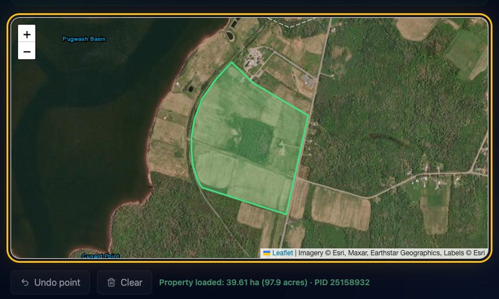 | 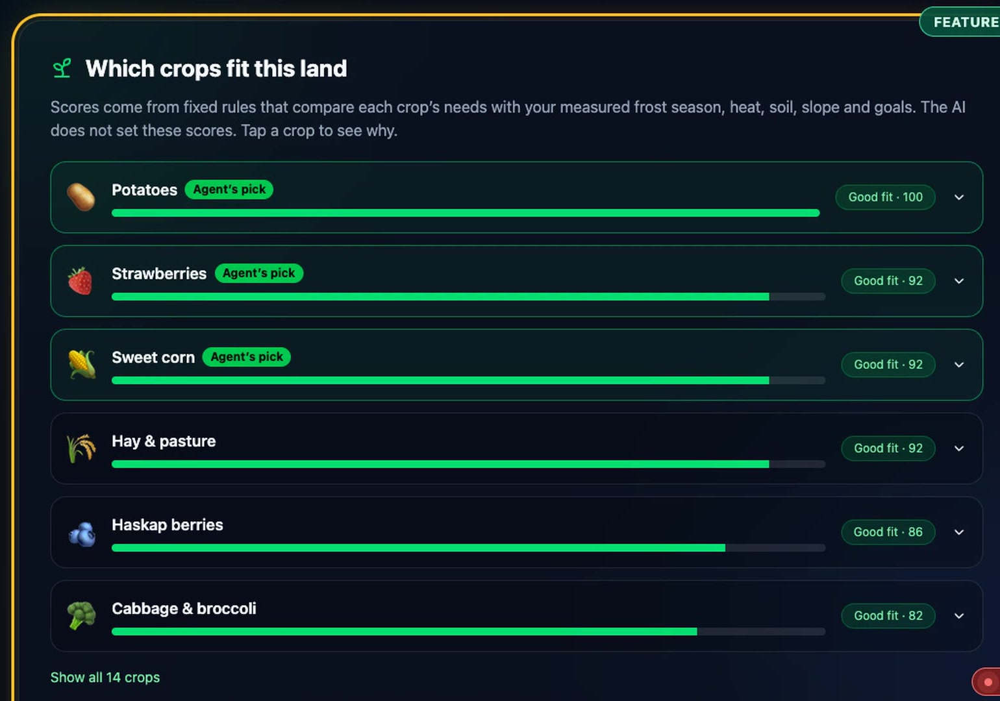 |
| **③ First steps to do, in order** | **④ 12-month calendar** |
| 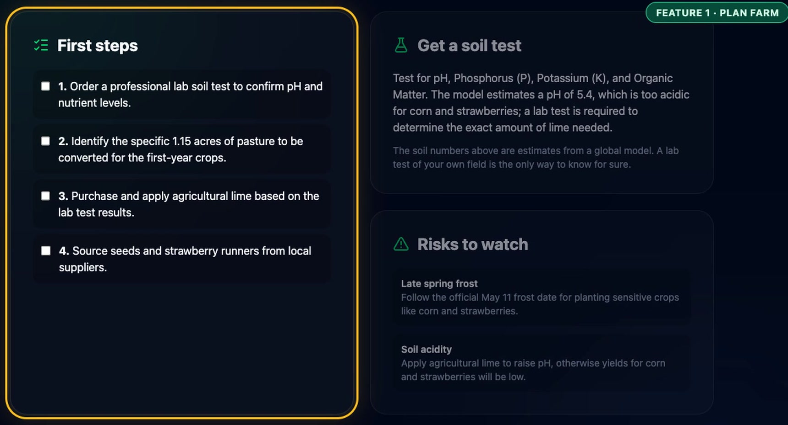 | 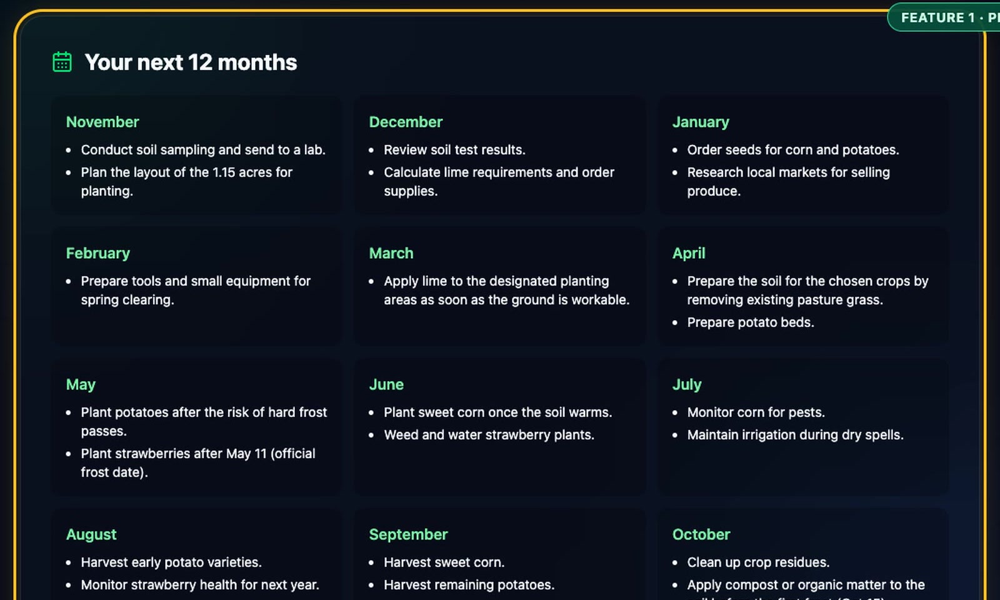 |
| **⑤ Money, with Statistics Canada sources** | **⑥ Sustainability score** |
| 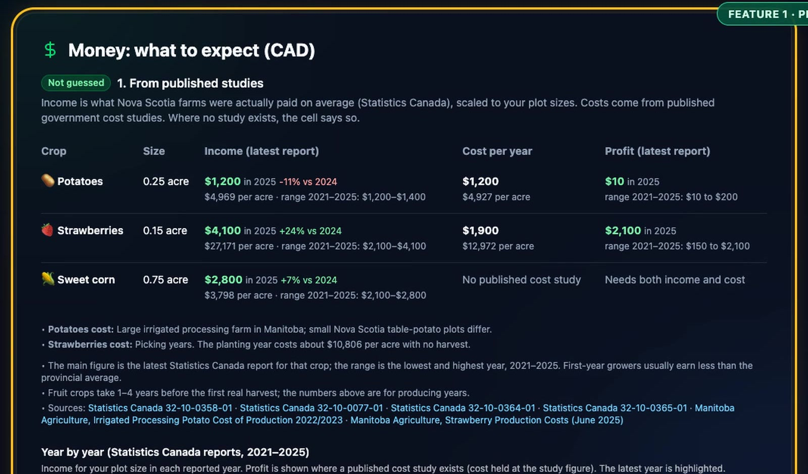 | 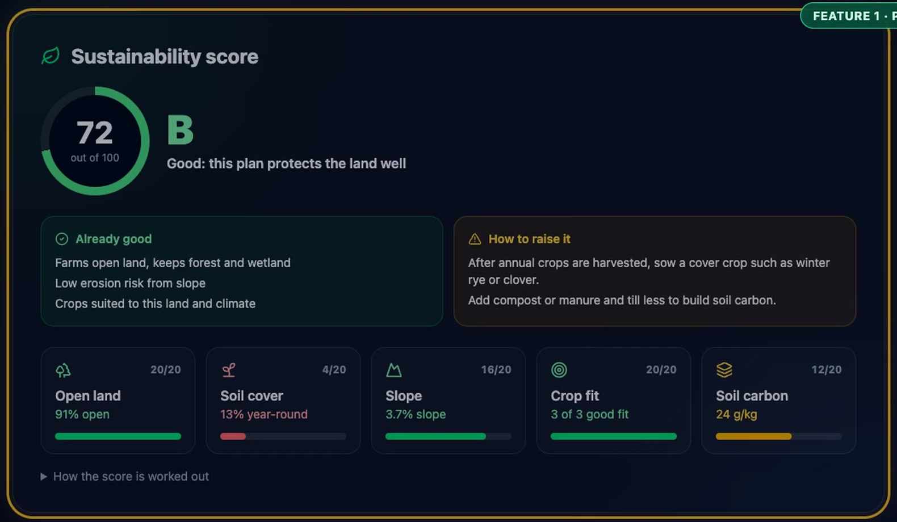 |

### Feature 2 · Climate Risk (`/climate-risk`)

Filled in from the saved plan. For any of the 14 Nova Scotia crops it gives:

- a **0–100 risk score**: heat stress + drought (+ NASA satellite greenness in the growing season) × the crop's weather sensitivity
- **now** (last 30 days + 7-day forecast) or **looking back** at any past month this year
- an AI explanation grounded in the plan's facts
- **what to plant right now**, with a fit rating (for Sam in November: garlic, winter rye and crimson clover)

Sam's strawberries, looking back at July 2026: **36 / 100, moderate** (32% heat stress, 33% drought, NDVI 0.76).

| ① Risk score with an AI explanation | ② What Sam can plant right now |
|---|---|
| 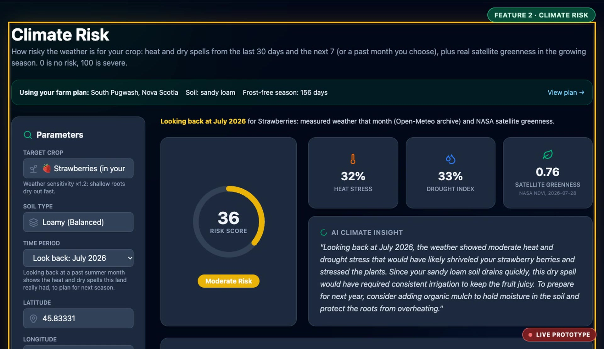 | 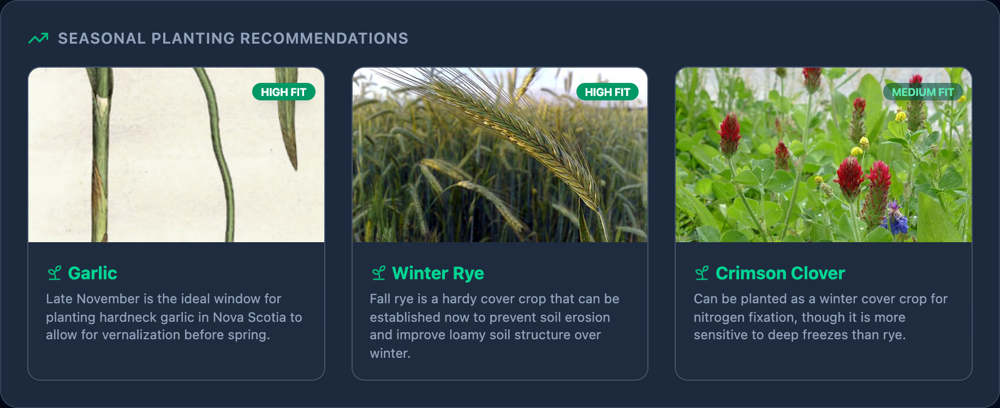 |

### Feature 3 · Crop Care (`/crop-care`)

Filled in from the saved plan (crop, plot size, place, first steps as to-dos):

- **Photo diagnosis:** likely causes and treatments, with a reminder to confirm with an advisor
- **7-day forecast** for the farm's exact coordinates
- **Chat assistant** that answers from the plan's verified facts (official frost dates, soil, slope)
- **Yield and money:** income from Statistics Canada; the yield is labelled as an AI estimate

<p align="center">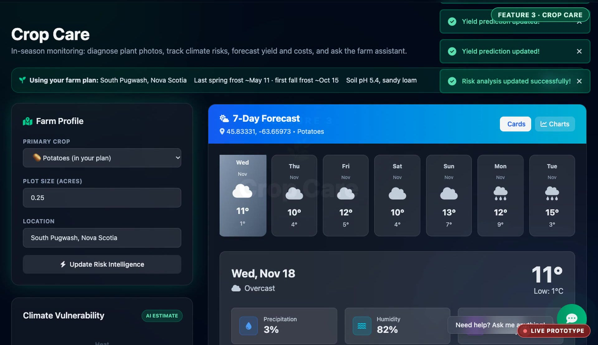<br><sub>① The plan carries over, with a 7-day forecast for the exact field</sub></p>

| ② Photo diagnosis | ③ Chat assistant using the plan's facts |
|---|---|
| 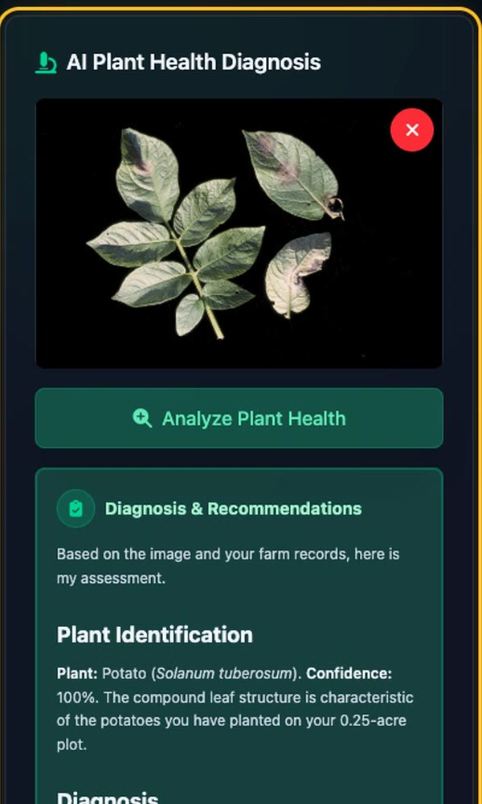 | 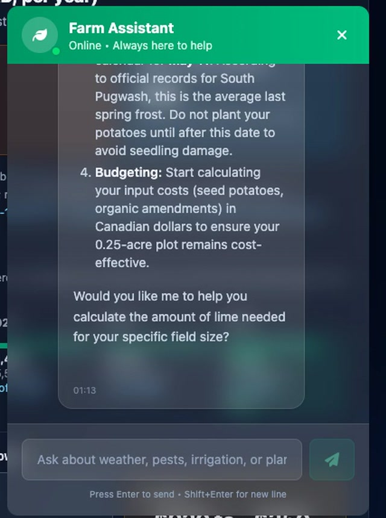 |

---

## How the AI agent works (agentic AI)

Plan Farm is an **agent**, not a single prompt. The AI (Gemma 4 31B, with function calling) runs its own research: it picks a tool, reads the result, decides what to check next, then reviews and fixes its own work.

<p align="center">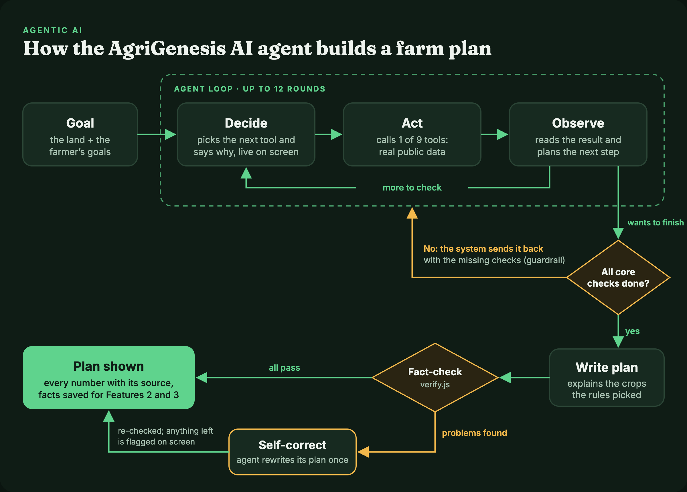</p>

| Agentic behaviour | How it is done |
|---|---|
| **Autonomy** | The agent decides which tools to call and in what order. Each call shows on screen with its reason. |
| **Tool use** | 9 tools, listed below, each backed by a real public data source |
| **Guardrails** | If it tries to finish before every core check, the system sends it back with the missing checks |
| **Self-reflection** | `verify.js` fact-checks the plan; the agent gets the problems and rewrites its plan once |
| **Memory** | The plan's verified facts are saved and carried into Climate Risk and Crop Care, so their AI answers stay grounded |

### The agent's tools

| Tool | Real data source | What it tells the agent |
|---|---|---|
| `check_official_climate_normals` | Environment and Climate Change Canada, Climate Normals 1981–2010 (nearest station) | Average last spring frost, first fall frost, frost-free days, degree days |
| `check_climate_history` | Open-Meteo historical weather (ERA5), last 10 years | Year-to-year variation, summer rain, coldest nights (cross-check only) |
| `check_soil` | Agriculture and Agri-Food Canada, Soil Landscape Grids (100 m); backup ISRIC SoilGrids 2.0 (250 m) | pH, sand/silt/clay, texture, organic carbon for the top 30 cm (estimate) |
| `check_terrain` | Open-Meteo Elevation (Copernicus DEM 90 m) | Slope %, direction the land faces, elevation |
| `check_satellite_vegetation` | NASA MODIS MOD13Q1 NDVI via ORNL DAAC | Greenness now and at last summer's peak, cloudy readings removed |
| `check_land_use` | AAFC Annual Crop Inventory (30 m) | What has been on the land for 3 years: hay, crops, forest, wetland, buildings |
| `check_weather_forecast` | Open-Meteo forecast | Next 14 days: frost nights, rain |
| `rank_crops` | Rules in `crops.js` (14 Nova Scotia crops) + Statistics Canada income in `economics.js` | A 0–100 score per crop with reasons; the fixed picks, plot sizes and CAD income |
| `get_crop_details` | `crops.js` | Growing needs, planting and harvest timing for one crop |

---

## Architecture

<p align="center">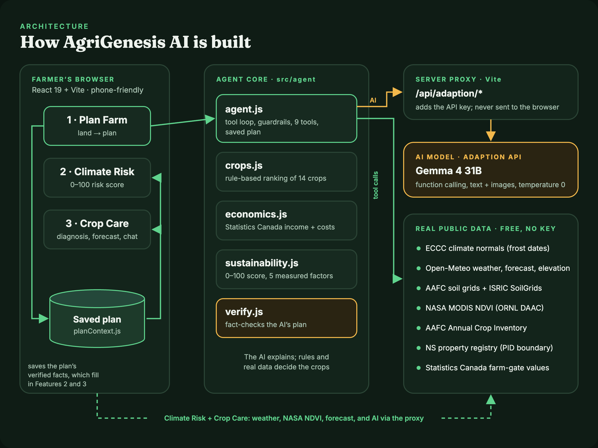</p>

- The API key has no `VITE_` prefix, so it never ships to the browser. The Vite server adds it to `/api/adaption/*` requests.
- Every data service is free and needs no key.
- Without an AI key, Plan Farm still shows all the measured data and the rule-based crop ranking.

---

## Why it can be trusted

Reliability rules are enforced in code, not left to the AI:

- **The AI explains; rules and data decide.** Crop scores, crop picks and plot sizes come from fixed rules, so the same land and goals always get the same crops.
- **Repeatable:** the AI runs at temperature 0, and the same inputs on the same day reuse the saved plan.
- **Locked location:** tools always use the farm's verified coordinates; the AI cannot change them.
- **No made-up money:** income comes only from Statistics Canada farm-gate values for Nova Scotia (latest year, with 2021–2025 shown beside it). Costs come from published government studies. A separate, clearly labelled AI estimate is shown for comparison.
- **Self-review:** `verify.js` checks planting months against the crop rules and the official last frost, quoted frost dates, every dollar figure, soil pH, the crops planted and the soil-test advice.
- **Official frost dates:** these come from Environment Canada station records; the weather model is only a cross-check, because it misses cold nights in Nova Scotia by weeks.
- **Honest soil:** soil values are labelled as estimates, and every plan recommends a lab soil test.
- **Graceful failure:** if the AI fails, the farmer still gets all measured data and the rule-based ranking.

---

## Getting started

Requires Node.js 20.19+ (or 22.12+).

```bash
git clone https://github.com/venky-22/agrigenesis-ai.git
cd agrigenesis-ai
npm install
```

Create a `.env` file in the project root. It is git-ignored; never commit it.

```env
# Powers every AI feature (ask the team for the key)
ADAPTION_API_KEY=your_adaption_key_here
```

```bash
npm run dev      # http://localhost:5173
npm run build    # production build into dist/
npm test         # 32 automated tests (Vitest)
```

**Try it:** open Plan Farm, enter PID `25158932` in "Have your PID?" (Sam's land near Pugwash), set the goals and build the plan. Then open Climate Risk and Crop Care from the plan page.

---

## Project layout

```
src/
├── App.jsx                       routes
├── agent/
│   ├── agent.js                  agent loop, tools, guardrails, saved plan
│   ├── data.js                   real-data tools (climate, soil, slope, NDVI, land use, forecast, PID)
│   ├── crops.js                  Nova Scotia crop needs, ranking, picks, season stages
│   ├── economics.js              Statistics Canada income + published costs per acre (CAD)
│   ├── aiCosts.js                clearly labelled AI cost estimate, for comparison
│   ├── sustainability.js         0–100 sustainability score from 5 measured factors
│   ├── verify.js                 fact-checker for the AI-written plan
│   └── planContext.js            shares the saved plan's facts with Climate Risk and Crop Care
├── components/                   app shell, field map, farm preview, income history
├── pages/                        Landing, Plan Farm input, farm plan results
├── services/ai.js                shared AI client (Adaption via the server proxy)
└── features/
    ├── climate-risk/             risk engine, gauge, weather and NDVI charts
    └── crop-care/                diagnosis, forecast, yield, money, chat
tests/                            automated tests: crop rules, income, sustainability score, fact-checker
submission/                       demo video, slide deck, thumbnail, subtitles, mentor decks, deck source
docs/                             README images and screenshots
```

---

## Known limitations

- **Soil is a model estimate** (AAFC Soil Landscape Grids, backup SoilGrids), not a field measurement. Where neither has data, the plan says soil is unknown.
- **Property boundaries (PID lookup)** come from Service Nova Scotia's NSPRD map service under its Restricted Geographic Services License: viewing is allowed with attribution and an accepted disclaimer (both shown in the app). Boundaries are from the land registry, not surveyed. Confirm with Service Nova Scotia before a public launch that measuring area from the boundary is covered.
- **Costs** come from published studies only: Manitoba Agriculture (potatoes 2022/23, strawberries 2025, barley 2026) and Nova Scotia (hay 2011, wine grapes 2014). Other crops show "no published cost study". Manitoba farms are larger, so small Nova Scotia plots will differ.
- **Climate normals are 1981–2010**; recent seasons have tended to be a little longer.
- **Satellite and land-use pixels** (250 m and 30 m) can mix small fields with roads, woods or neighbours.
- **Crop needs** in `crops.js` are general guideline values and should be reviewed against Perennia/AAFC guides.
- **Crop Care yields** are an AI estimate (revenue is not: it comes from Statistics Canada).
- **AI diagnoses can be wrong.** Confirm with an extension specialist before treating crops.
- **Wording can vary slightly** between browsers; crops, sizes, money and facts do not.
- **Deploying:** the key proxy exists only in `npm run dev` / `npm run preview`. A hosted deploy needs an equivalent serverless function for `/api/adaption/*`.

## Roadmap

1. **Atlantic Canada first:** New Brunswick, Prince Edward Island, and Newfoundland and Labrador
2. **Then all of Canada**
3. Hosted launch with a serverless key proxy
4. French and plain-language modes
5. Crop rules reviewed with Perennia, and Nova Scotia cost studies for vegetables, apples and blueberries
6. Plan updates from in-season progress photos
